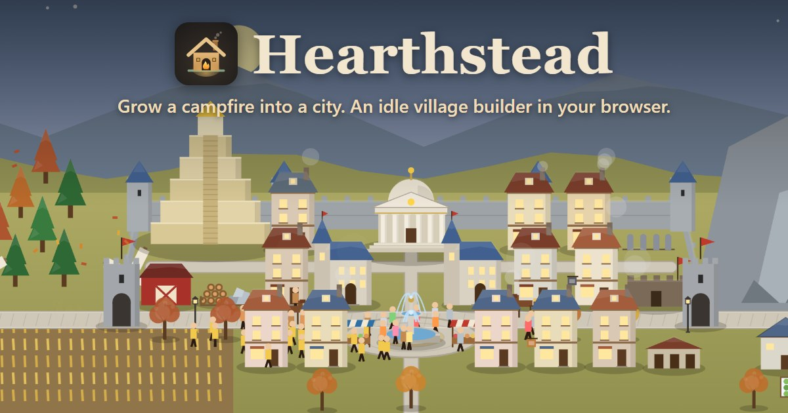
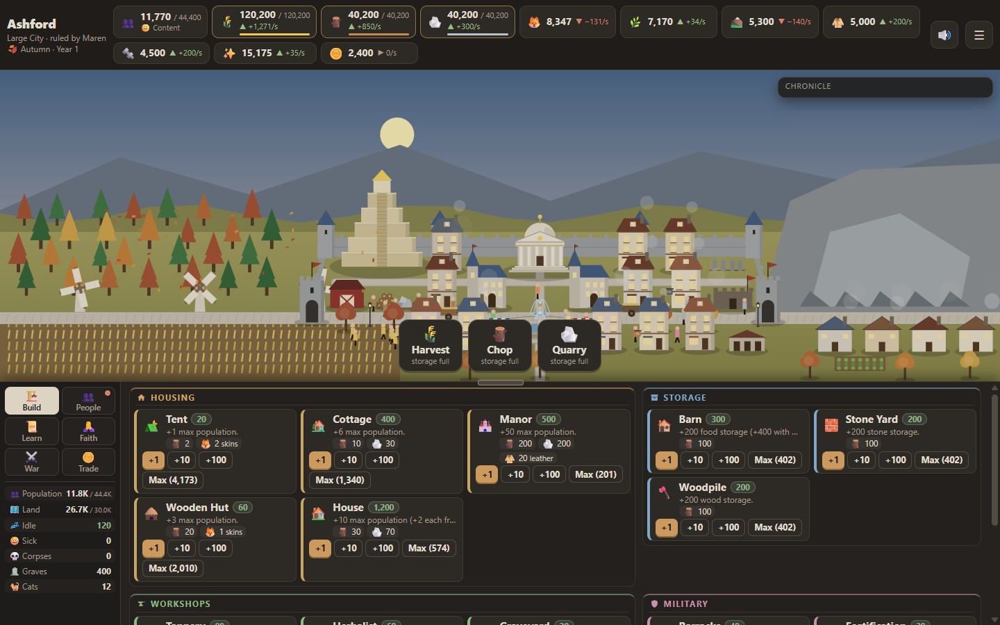
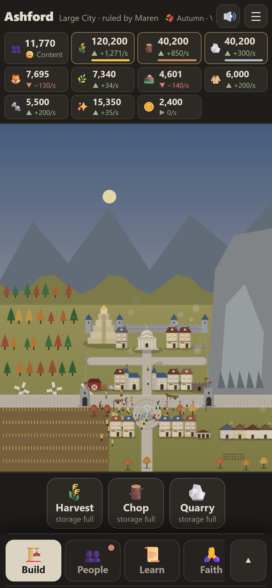

# Hearthstead

A 2D civilization clicker that runs in your browser, on desktop or phone. Grow a single tent into an empire: gather by hand, recruit citizens, put them to work, build, learn, worship, fight, trade and raise wonders.

### ▶ [Play Hearthstead](https://ximmersivex.github.io/hearthstead/)

Free, no sign-up, and it works offline once loaded. You can install it as an app (see below).

  
  &nbsp;
  

## Features

- **A village that grows on screen.** The picture is drawn in code and changes with your population: camp, hamlet, village, town and city, with roads, a plaza, market stalls, walls, a temple and your wonders.
- **The full classic idle-civ economy:** food, wood and stone, special finds (skins, herbs, ore), leather and metal workshops, storage caps, land, morale, sickness and burial.
- **Jobs, upgrades and faith:** ten jobs, a tech tree, a deity with four domains, altars, blessings and prayers.
- **War and trade:** wolves, bandits and barbarians, raids for land and plunder, travelling merchants, gold.
- **Wonders and New Ages** for long-term play, plus achievements.
- **Seasons** with seasonal looks, optional seasonal farming and choice events.
- **Comfortable for long sessions:** six colour themes, four panel layouts (bottom, left, right, classic), a resizable panel, instant tooltips, sound and music made in code.
- **Phone-friendly:** a drawer layout with big buttons and fast multi-tap gathering.
- **Installable and offline:** a Progressive Web App with its own icon. Saves stay in your browser and keep working while you're away.

## Install it as an app

- **Android (Chrome):** open the play link, then tap **⋮ → Add to Home screen** (or **Install app**).
- **iPhone / iPad (Safari):** open the play link, tap **Share**, then **Add to Home Screen**.
- **Desktop (Chrome or Edge):** click the install icon at the right end of the address bar.

The installed app opens full screen and plays offline. When online it always loads the newest version.

The rules and numbers follow the classic CivClicker design closely (same population, food, jobs, buildings, upgrades, sickness, combat, trade, faith and wonder mechanics), with its own name, text and look.

Inspired by [CivClicker](https://github.com/deathraygames/civ-clicker) by David Holley and its contributors. Hearthstead is a separate, from-scratch implementation and contains none of CivClicker's code, art or text.

## How to open it

**Easiest:** double-click `index.html`. It opens in your browser and you can play. Nothing to install, no internet needed, no libraries.

**On your phone:** serve the folder from your PC. Open a terminal in this folder and run `python -m http.server 8000` (or `npx serve`), then on your phone (same Wi-Fi) go to `http://YOUR-PC-IP:8000`.
## How to play

- **Click** the fields, forest and quarry in the picture (or the Harvest / Chop / Quarry buttons, or keys **1 2 3**) to gather food, wood and stone. Each click has a 10% chance to also find **skins, herbs or ore**.
- Build a **Tent** (2 wood, 2 skins) so someone can live there, then **recruit** citizens for 20 food each (a little more as you grow).
- Every citizen eats **1 food per second**. A farmer grows 1.2. Run out of food and people starve.
- **Jobs:** farmers, woodcutters, miners; tanners (skins → leather), blacksmiths (ore → metal), healers (cure the sick with herbs), priests (faith, and they bury the dead), builders (wonders), soldiers and riders.
- **Storage** is capped at 200 each for food, wood and stone. Barns, woodpiles and stone yards add more.
- **Learn** tab: Masonry, Construction and Architecture unlock buildings; other upgrades boost farming, special resources, clicking, combat and more.
- **Corpses** spread sickness. Graveyards give graves, priests fill them, healers cure the sick.
- **Morale** speeds up or slows down all work. Starvation and overcrowding (building on more land than you own) hurt it.
- **Faith:** with a Shrine, priests make faith. Learn Worship, name a deity, pick its domain (War, Harvest, the Dead, the Hearth), and build altars for devotion. Devotion unlocks blessings and prayers.
- **War:** wolves attack from time to time (bandits past 1,000 people, barbarians past 10,000). Soldiers and riders defend. Raise a War Banner to send raiding parties for land and plunder.
- **Trade:** merchants visit for a few seconds and pay 1 gold for a big pile of one resource. Gold buys goods and hurries wonders.
- **Wonders** (after Architecture and Civil Service) give a permanent +10% to one resource. Then you can start a **New Age** from the menu, keeping past gods, wonders, cats and achievements.

## Saving

- The game saves itself in your browser every 10 seconds and when you close the tab.
- While you're away (up to 8 hours) your people keep working. Nobody starves, gets sick or is attacked while you're gone.
- **☰ Menu → Export save** gives you a code (or a file) you can **Import** on another browser or device.

## Changing the game

All the numbers and names are in `js/data.js`. Edit, save, and refresh the page.

| File | What it does |
| --- | --- |
| `index.html` | The page layout |
| `manifest.json`, `sw.js`, `icons/` | App install details, offline support (service worker) and app icons. `icons/icon.svg` is the source drawing. |
| `images/` | README screenshots and the link-preview image |
| `css/style.css` | Look of the top bar, side panel and the phone drawer |
| `css/look-table.css` | The newer controls layout: a table of tiles along the bottom. Switch in ☰ Menu → Controls layout. Drag the grip on the panel's top edge to resize it (double-click to reset). |
| `js/data.js` | **Game content and balance** |
| `js/sim.js` | The economy, population, sickness, combat, faith, trade, wonders, saving |
| `js/seasons.js` | Seasons (season clock, seasonal farming) and choice events; turn effects on in Menu → Seasons |
| `js/scene.js` | The village picture (drawn in code on a canvas) |
| `js/ui.js` | Top bar, panel tabs, menus, messages |
| `js/audio.js` | All sound effects and the music, made in code (no sound files) |
| `js/main.js` | Starts everything and runs the game loop (one tick per second) |

Tip: open the browser console (F12) and type `game.state.res.food = 200` to cheat a little while testing.

## License

MIT, see [LICENSE](LICENSE). CivClicker itself is GPL-3.0; Hearthstead shares its game design but none of its code.
